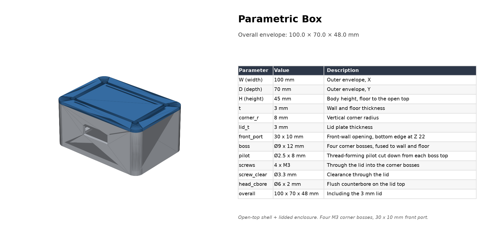

# AI-CAD · 用代码构建参数化 3D 模型

把 CAD 从 GUI 操作变成**可版本控制、可复现、可参数化**的代码。模型用
[CadQuery](https://github.com/CadQuery/cadquery)（默认）、OpenSCAD 或
Build123d 编写，仓库内的 `cad-code` skill 让 AI 助手按同一套流程完成建模、
网格校验、预览渲染和规格出图。



## 这个仓库能做什么

- **参数化建模**：所有尺寸集中在脚本顶部，改参数后重新运行即可更新模型。
- **AI 协作**：`skills/cad-code` 提供完整的工作流、三种工具的语法参考和
  通用的校验/渲染/出图脚本，AI 助手读取后可直接执行，而不是只生成未经验证的代码。
- **几何校验**：导出后检查退化三角面、非流形边和单位/尺度异常。
- **预览与规格图**：无显示器依赖的 matplotlib 渲染，支持单件和多色装配；
  自动生成「渲染 + 参数表」规格图。
- **多部件装配**：每个部件独立命名、独立着色，STEP 保留装配结构。
- **图纸驱动**：可解析 2D DXF 平面图，生成带门窗开口的 3D 墙体。
- **标准输出**：STL（3D 打印）、STEP（CAD 交换）、PNG（预览/规格）。

## 目录结构

```
AI-CAD/
├─ README.md
├─ LICENSE                     # MIT
├─ requirements.txt            # 运行依赖
├─ skills/
│  └─ cad-code/                # AI 建模 skill
│     ├─ SKILL.md              # 工作流、工具选择、设计原则
│     ├─ references/           # OpenSCAD / CadQuery / Build123d 参考
│     └─ scripts/              # 校验、渲染、规格图、DXF 解析
├─ examples/
│  └─ parametric-box/          # 可发布的测试样例
│     ├─ box_cq.py             # 参数化源文件
│     ├─ rows.json             # 规格表数据
│     ├─ README.md             # 样例说明
│     └─ output/               # STL / STEP / PNG
└─ _private/                   # 本地私有项目，已被 .gitignore 忽略
```

约定：**一个模型一个目录**；源文件、参数表和模型说明放在目录根部，
生成物统一放进该目录的 `output/`，不要手工修改 `output/` 里的文件。

## 环境要求

| 项目 | 要求 |
|---|---|
| Python | 3.10–3.12（推荐 3.11） |
| Git | 任意较新版本 |
| 核心依赖 | CadQuery 2.8+、CQ-editor 0.7+、numpy、matplotlib、numpy-stl、ezdxf |
| 可选 | OpenSCAD（`.scad` 模型）、Build123d |

CadQuery 依赖较大的 OCP 轮子，首次 `pip install` 会下载较多内容，属于正常现象。

## 从零开始

### 1. 获取代码

```bash
git clone https://github.com/GarinGao/AI-CAD.git
cd AI-CAD
```

如果你 fork 了仓库，把地址换成分叉后的仓库地址。

### 2. 创建并激活虚拟环境

**Windows PowerShell**

```powershell
python -m venv .venv
.\.venv\Scripts\Activate.ps1
python -m pip install --upgrade pip
```

如果提示脚本被禁用，可只在当前窗口放行：

```powershell
Set-ExecutionPolicy -Scope Process -ExecutionPolicy Bypass
```

**macOS / Linux**

```bash
python3 -m venv .venv
source .venv/bin/activate
python3 -m pip install --upgrade pip
```

### 3. 安装依赖（含 CQ-editor）

```bash
python -m pip install -r requirements.txt
```

验证安装：

```bash
python -c "import cadquery, stl, numpy, matplotlib, ezdxf, cq_editor; print('ok', cadquery.__version__)"
```

启动图形预览器：

```bash
cq-editor examples/parametric-box/box_cq.py
```

在 CQ-editor 窗口中按 `F5` 运行脚本，即可交互查看模型。样例脚本同时支持
`python box_cq.py` 和 CQ-editor 两种入口。CQ-editor 需要图形桌面环境；
无桌面的服务器或 CI 只运行脚本与 headless 渲染即可。

### 4. 可选扩展

- **OpenSCAD**：只在需要 `.scad` 模型时安装（Windows 安装包 / macOS
  `brew install --cask openscad` / Linux 发行版包管理器）。
- **Build123d**：需要另一种 Python 建模 API 时执行 `python -m pip install build123d`。
- **ezdxf**：已包含在 `requirements.txt`，仅 DXF 图纸流程会用到。

### 5. 给 AI 助手配置 skill

`skills/cad-code` 是普通文件夹，不需要构建。按你的 AI 助手支持的方式二选一：

**方式 A：支持 skills 目录**

把 `skills/cad-code` 复制或软链接到该助手约定的 skills 目录（具体位置以
助手自身的文档为准）：

```bash
cp -r skills/cad-code <your-assistant-skills-directory>/
```

**方式 B：不支持 skills 目录**

保留仓库目录不变，在开始 CAD 任务前明确要求助手：

> 先读取 `skills/cad-code/SKILL.md`，按其中的工作流建模、运行、校验并输出规格图。

然后用一条小任务验证配置是否生效：

> 按 `skills/cad-code/SKILL.md` 的工作流，用 CadQuery 新建一个
> 80 × 60 × 30 mm 的开口盒，导出 STL/STEP，校验网格并生成规格图。

助手应当能自行选择工具、运行 Python、调用 `skills/cad-code/scripts/` 下的脚本，
而不是只返回一段未执行的代码。

### 6. 运行测试样例

```bash
cd examples/parametric-box
python box_cq.py
```

再执行校验、渲染和规格图：

```bash
python ../../skills/cad-code/scripts/check_model.py output/body.stl --expect-max-dim 200
python ../../skills/cad-code/scripts/render_assembly.py output/render_iso.png --parts output/parts.json --view iso
python ../../skills/cad-code/scripts/spec_sheet.py output/render_iso.png output/spec_sheet.png --title "Parametric Box" --rows rows.json --bbox 100,70,48
```

运行后 `output/` 中应出现 `body.stl`、`body.step`、`lid.stl`、`lid.step`、
`box_assembly.stl`、`box_assembly.step`、`parts.json`、`render_iso.png`、
`render_front.png` 和 `spec_sheet.png`。

### 7. 新建自己的模型

```bash
mkdir examples/my-part
```

按样例目录的结构放置：

```
examples/my-part/
├─ my_part_cq.py     # 参数化源文件
├─ rows.json         # [参数名, 数值, 说明] 列表
├─ README.md         # 假设、装配、打印设置
└─ output/           # 运行脚本后生成
```

如果不准备发布，把项目放进 `_private/`（该目录已被 `.gitignore` 忽略）。

建模时遵循 `SKILL.md` 的约定：

1. 尺寸全部作为命名参数放在脚本顶部。
2. 一个命名部件对应一个函数，最后用一个顶层装配函数组合。
3. 所有导出写入模型目录的 `output/`。
4. 先运行脚本，再校验 STL，最后渲染和生成规格图。
5. 报告尺寸从几何包围盒读取，不要照抄输入参数。

## AI 工作流

`skills/cad-code/SKILL.md` 定义了完整闭环：

1. **选择工具**：`.scad` 用 OpenSCAD；通用参数化零件用 CadQuery；需要
   Build123d API 时用 Build123d。
2. **准备环境**：检查并安装对应工具链。
3. **编写脚本**：参数化、模块化、可扩展。
4. **实际运行**：在导出前修正几何错误。
5. **导出**：打印用 STL，CAD 交换/制造用 STEP。
6. **校验**：`check_model.py` 检查退化面、非流形边和尺度。
7. **出图**：`render_stl.py` 或 `render_assembly.py` 渲染，`spec_sheet.py`
   合成规格图。

## 常用命令

| 目的 | 命令 |
|---|---|
| 图形预览 | `cq-editor examples/parametric-box/box_cq.py`（按 `F5`） |
| 运行模型 | `python <model>_cq.py` |
| 网格校验 | `python skills/cad-code/scripts/check_model.py model.stl --expect-max-dim 500` |
| 单件渲染 | `python skills/cad-code/scripts/render_stl.py model.stl preview.png --view iso` |
| 多色装配渲染 | `python skills/cad-code/scripts/render_assembly.py preview.png --parts parts.json` |
| 规格图 | `python skills/cad-code/scripts/spec_sheet.py render.png spec.png --title "Part" --rows rows.json --bbox x,y,z` |
| 解析 DXF 平面图 | `python skills/cad-code/scripts/dxf_floorplan.py plan.dxf plan.json` |
| DXF 生成墙体 | `python skills/cad-code/scripts/build_from_floorplan.py plan.json out_prefix` |

## 常见问题

**CadQuery 安装失败或很慢**
确认 Python 版本在 3.10–3.12；使用虚拟环境；OCP 轮子较大，首次下载慢属正常。
网络受限时可换用可达的 PyPI 镜像。

**`ModuleNotFoundError: No module named 'stl'`**
安装 `numpy-stl`：`python -m pip install numpy-stl`。

**PowerShell 无法激活虚拟环境**
执行 `Set-ExecutionPolicy -Scope Process -ExecutionPolicy Bypass` 后重试。

**预览图有面片前后遮挡错误**
渲染脚本使用画家算法排序，复杂/凹陷模型可换 `front`、`top`、`right` 视图
多生成几张再挑选。

**校验报告非流形边**
常见原因是两个独立旋转的实体只共边、切口与壁面完全重合，或布尔体没有
充分重叠。让切除体多伸出 `0.01 mm`，并先查看建模工具自身的警告。

**DWG 文件无法读取**
DWG 是专有二进制格式，没有可靠的开源读取器；先用 CAD 软件或转换工具另存为
DXF，再使用 `dxf_floorplan.py`。

## 许可

MIT License，详见 [LICENSE](LICENSE)。欢迎提交 issue 和 pull request。
