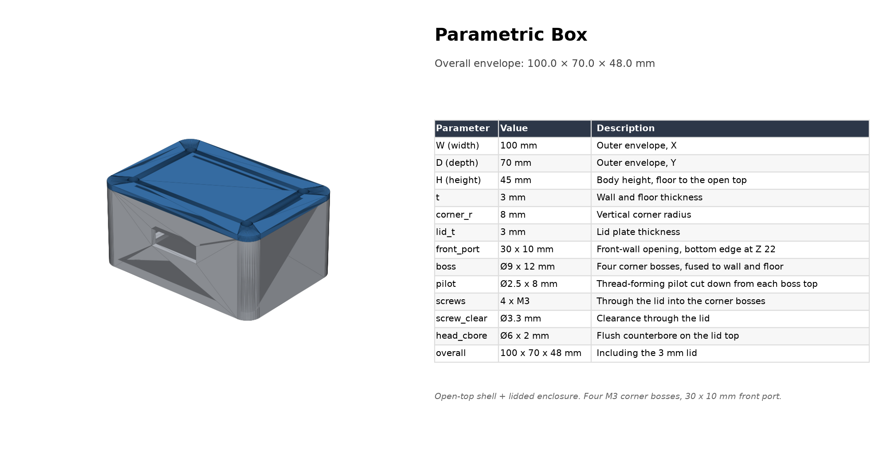

# parametric-box — 带盖板参数化外壳（示例）

这是一个用于验证仓库工具链的最小测试样例：一个 **100 × 70 × 45 mm** 的
CadQuery 参数化外壳，带 3 mm 盖板和 4 颗 M3 螺丝。它刻意保持简单，适合作为
新建模型时的起点。



## 结构

| 部件 | 说明 |
|---|---|
| `body` | 五面开口壳体：3 mm 壁厚与底板、R8 竖直角、4 个 M3 角柱、前壁 30 × 10 mm 开口 |
| `lid` | 3 mm 盖板：与壳体相同的 R8 外轮廓，4 × Ø3.3 通孔 + Ø6 × 2 mm 沉头 |
| `box_assembly` | 合并后的整机 STL / 带颜色 STEP |

参数全部集中在 [box_cq.py](box_cq.py) 顶部，修改后重新运行即可，无需手工改模型。

## 从零运行

在仓库根目录完成 README 中的环境安装后：

```bash
cd examples/parametric-box
python box_cq.py
```

也可以直接用 CQ-editor 打开并预览：

```bash
cq-editor box_cq.py
```

在 CQ-editor 窗口中按 `F5` 运行脚本，交互查看模型；`python box_cq.py`
则直接导出文件。

产物写入 `output/`：

```
output/
├─ body.stl / body.step
├─ lid.stl / lid.step
├─ box_assembly.stl / box_assembly.step
├─ parts.json                # 多色渲染清单
├─ render_iso.png            # 等轴预览
├─ render_front.png          # 正视图
└─ spec_sheet.png            # 渲染 + 参数表
```

校验与出图（在 `examples/parametric-box` 目录下执行）：

```bash
python ../../skills/cad-code/scripts/check_model.py output/body.stl --expect-max-dim 200
python ../../skills/cad-code/scripts/check_model.py output/lid.stl --expect-max-dim 200

python ../../skills/cad-code/scripts/render_assembly.py output/render_iso.png \
  --parts output/parts.json --view iso

python ../../skills/cad-code/scripts/render_assembly.py output/render_front.png \
  --parts output/parts.json --view front

python ../../skills/cad-code/scripts/spec_sheet.py output/render_iso.png output/spec_sheet.png \
  --title "Parametric Box" --rows rows.json --bbox 100,70,48 \
  --notes "Open-top shell + lidded enclosure. Four M3 corner bosses, 30 x 10 mm front port."
```

## 主要尺寸

| 参数 | 值 | 说明 |
|---|---|---|
| 外形 | 100 × 70 × 45 mm | 不含盖板 |
| 整机 | 100 × 70 × 48 mm | 含 3 mm 盖板 |
| 壁厚 / 底板 / 盖板 | 3 mm | FDM 可直接打印 |
| 竖直角 | R8 | 内外圆角同心，转角壁厚保持 3 mm |
| 前壁开口 | 30 × 10 mm | 下沿 Z 22 mm |
| 角柱 | Ø9 × 12 mm | 对称四角，与壁和底板融合 |
| 螺丝 | 4 × M3 | 盖板通孔 Ø3.3，沉头 Ø6 × 2 |
| 角柱螺孔 | Ø2.5 × 8 mm | M3 自攻/螺纹成型，建议手拧 |

## 打印与装配

- 壳体开口朝上打印，底板直接贴床，无需支撑；盖板平放打印。
- M3 螺丝从盖板沉头孔拧入角柱的 Ø2.5 底孔。首次拧入会自行成型螺纹，
  建议先手拧定位，再逐颗拧紧，避免滑牙。
- 需要更高强度时把 `pilot_d` 改为 2.7–2.8 mm，或改用 M3 机牙螺丝 +
  金属嵌件（同时把底孔改为嵌件外径）。
- 前壁开口、角柱位置和盖板厚度都由脚本顶部参数控制；改完重新运行
  `python box_cq.py`，STL/STEP/规格图会一起更新。

## 设计说明

- 内腔圆角取 `corner_r - t`，保证转角处壁厚均匀，不会出现薄壁。
- 所有切除体都比被切面多伸出 `EPS = 0.01 mm`，避免布尔运算留下零厚度面。
- 盖板与壳体使用同一组 `SCREW_XY` 坐标，孔位永远对齐；移动角柱只需改一处。
- 模型拆成 `body` / `lid` 两个命名部件，再通过 `cq.Assembly` 输出带颜色 STEP，
  后续增加部件不需要改动已有几何。
